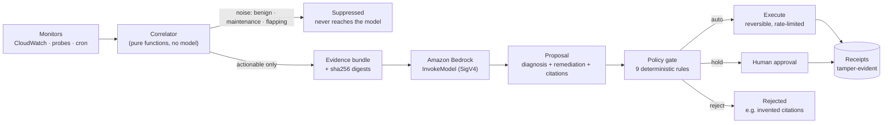

# NightShift

**Agentic on-call triage for MSPs. Deterministic correlation turns an alert flood into a handful of incidents, Amazon Bedrock diagnoses each one, and a policy gate decides whether a robot may act — with a verifiable receipt for every decision.**

Built for the **AWS MSP AI Hackathon**, Track 1: Run Your MSP Better.

**Live:** _(deploy pending — see [Hosting](#hosting))_ · **Video:** _(pending — script in [VIDEO.md](VIDEO.md))_ · **Limits:** [what this does not do yet](#honest-limits)

```
203 alerts  →  21 incidents  →  12 pages to a human
                                 6 auto-remediated · 6 held for approval
                                 0 false auto-actions · 0 real incidents missed
```

---

## Stage One, in one paragraph

**Bedrock is the product, not a garnish.** The deterministic layer decides *what deserves attention*;
the model decides *what is wrong and what to do about it*. Delete the Bedrock call and there is no
diagnosis, no remediation proposal and nothing for the gate to grade — all that remains is a noise
filter. The AWS AI service sits in the live path at `src/agent/index.js`, called over SigV4-signed
Bedrock `InvokeModel` in `src/agent/bedrock.js`. The theme fit is direct: this is the
"multi-agent incident response / automated triage" example named in the Track 1 brief.

---

## How NightShift meets the judging criteria

Four criteria, 25% each.

| Criterion | How we meet it | Where |
|---|---|---|
| **Technological Implementation** | Bedrock in the live path, signed from scratch with zero dependencies. Around it: a pure-function correlation engine, a nine-rule policy gate, tamper-evident evidence receipts, a two-tenant benchmark and **35 passing tests** including adversarial ones. | [§1](#1-technological-implementation) |
| **Design** | The whole on-call loop in one console: what came in, what was suppressed and why, what the model proposed, what the gate decided, what a human still owes. Multi-tenant from the contracts up — **onboarding a customer is writing a JSON rule pack, not editing code**. | [§2](#2-design) |
| **Potential Impact** | A reproducible benchmark with a published baseline: **94.1% of alert volume removed, with zero real incidents missed**. Every number regenerates from `npm run eval`. | [§3](#3-potential-impact) |
| **Innovation / Idea** | The novelty is *where the model sits*. It proposes; code decides. A proposal that cites evidence it was never shown is rejected automatically, and nothing irreversible ever runs unattended. | [§4](#4-innovation--idea) |

---

## 1. Technological Implementation

### Architecture



### The three layers, and why each exists

**1. Correlation (`src/correlate.js`) — deterministic, no model.**
Groups alerts by a normalised signature within a tenant's window. State verbs collapse to `<state>`
so `"Health check failed"` and `"Health check recovered"` land in **one** incident — without that, a
flapping probe looks like two healthy groups and is never detected as a flap. Classifies each
incident as `actionable`, `known_benign`, `suppressed_window`, `flapping` or `duplicate`.
Same alerts in, identical incidents out, always.

This also keeps the token bill sane: at MSP volume you cannot afford to send 203 alerts to a model.
We send 12 incidents.

**2. The agent (`src/agent/`) — Amazon Bedrock.**
Sees an evidence bundle and nothing else: the alert sample, the tenant's runbook, the correlator's
notes. Returns strict JSON — diagnosis, root-cause hypothesis, one remediation id from the tenant's
catalogue, a confidence, and the digests of the evidence it used. It executes nothing.

Bedrock is called over plain HTTPS with **SigV4 signed in `node:crypto`** (`src/agent/bedrock.js`).
No SDK, no `npm install`, nothing to break on a judge's machine.

**3. The gate (`src/policy.js`) — code decides.**
Nine rules, each one an answer to a question a customer will ask in a post-incident review:

| Rule | Outcome |
|---|---|
| Model cited evidence it was never shown | **reject** — a model that invents its justification is unusable |
| Remediation is not in this tenant's rule pack | **reject** |
| Incident was classified as noise | **reject** — nothing acts on suppressed traffic |
| Action is irreversible | hold for a human, always, no override |
| Blast radius is high | hold |
| Tenant has not opted this action into unattended use | hold |
| Rate limit reached for this action | hold — an agent in a loop is worse than no agent |
| Model confidence below 0.75 | hold |
| Incident is critical | hold — customer-facing calls stay human |

Everything else auto-remediates. Every verdict carries the list of rules that fired, in order.

### Receipts

Every decision stores the evidence verbatim, its sha256, and a digest over the ordered list.
Editing evidence after the fact, swapping it, or reordering it all break verification — and the
console re-verifies on load. "Why did your robot restart my service at 4am?" has an answer that is
not a log line.

### Tests

```
$ npm test
ℹ tests 35
ℹ pass 35
ℹ fail 0
```

Including: hallucinated citations rejected, irreversible actions never unattended, rate limits
honoured, critical incidents always held, tenant isolation, receipt tampering detected, and a test
that asserts the published headline numbers so the README cannot silently drift from the code.

---

## 2. Design

> "Can it be reproduced across different partner and customer environments?"

**Yes, and the repo proves it with two tenants that behave differently on identical traffic.**

There is no global config and no hardcoded environment. Every entry point takes a `tenantId` and a
`RulePack`. A rule pack is JSON: correlation window, flap threshold, maintenance windows, benign
patterns, and the catalogue of actions that tenant permits with per-action blast radius, rate limit
and opt-in. **Onboarding a customer is writing that file.**

| | Northwind MSP (internal NOC) | Acme Retail (managed customer) |
|---|---|---|
| Alerts in | 203 | 203 |
| Incidents | 21 | 21 |
| **Paged to a human** | **12** | **18** |
| Auto-remediated | 6 | 3 |
| Held for approval | 6 | 15 |
| False auto-actions | 0 | 0 |
| Missed real incidents | 0 | 0 |

Same code, same traffic, different outcomes — because Acme has not declared its benign log patterns
yet and has opted almost nothing into unattended execution. That is the correct behaviour for a new
customer: **a tenant you know less about pages you more.** Trust is configuration, and it is earned
per tenant rather than assumed globally.

The console covers the loop: KPI header, actionable incidents with the model's diagnosis and the
gate's verdict, a separate panel for everything suppressed *with the reason*, and a detail page
showing exactly what the model was shown, what it proposed, which rules fired, and the receipt.
Approve or decline from the incident page. Dark, responsive, no build step, no framework.

---

## 3. Potential Impact

### The problem

An MSP NOC drowns. A single failing scheduled job re-fires every 45 seconds; a library logs an
expected skip at ERROR; a probe flaps. On-call stops reading alerts, and the one that mattered —
`payments-gateway` refusing 100% of requests — arrives in the middle of that.

### Measured outcome

Reproduce with `npm run eval`:

| | Northwind MSP |
|---|---|
| Alerts ingested | 203 |
| Incidents after correlation | 21 |
| **Paged to a human** | **12** |
| **Alert volume removed** | **94.1%** |
| Auto-remediated (reversible, opted-in, rate-limited) | 6 |
| Held for human approval | 6 |
| **False auto-remediations** | **0** |
| **Real incidents missed** | **0** |

The last two lines are the ones that matter. A noise filter that also swallows the real outage is
worse than no filter, so the evaluation grades against ground-truth labels the pipeline never sees,
and `npm run eval` **exits non-zero** if either number is above zero. It is a release gate, not a
dashboard.

### What a judge should check

The reduction number is easy; the safety numbers are the claim. `src/eval/run.js` computes them from
labels attached by the generator and stripped before anything in the pipeline sees them
(`stripTruth()`), so the system is scored on data it was never shown the answers to.

---

## 4. Innovation / Idea

| Prior art | What it does | What NightShift does differently |
|---|---|---|
| Alert correlation (Opsgenie, BigPanda…) | Dedupes and groups alerts | Correlation is the *cheap* layer here; the model only sees what survives it |
| "LLM reads your logs" tools | Summarise incidents | Summaries are not decisions. Here the model names an action from a tenant-specific catalogue, and code decides whether it may run |
| Auto-remediation runbooks | Fire on static rules | The rule chooses *whether*; the model chooses *which*, and must cite the evidence it used |

The idea in one line: **the model proposes, deterministic code decides, and every decision leaves a
receipt.** That is what makes an unattended agent acceptable to an MSP that is contractually liable
for a customer's uptime.

---

## Run it (judges start here)

No AWS account, no credentials, no network, no `npm install`. Node 20+ only.

```bash
git clone <this repo> && cd nightshift
npm test                                      # 35 tests
npm run eval                                  # the benchmark, offline baseline
node src/eval/run.js --tenant acme-retail     # the second tenant
node src/server.js                            # console on http://localhost:3000
node src/export.js                            # static export to dist/
```

With Bedrock:

```bash
export AWS_ACCESS_KEY_ID=...  AWS_SECRET_ACCESS_KEY=...  AWS_REGION=us-east-1
export BEDROCK_MODEL_ID=anthropic.claude-3-5-sonnet-20240620-v1:0
AGENT_PROVIDER=bedrock npm run eval
```

The offline provider is the **published baseline**, not a mock of Bedrock: the eval runs the same
benchmark through either provider so the model's contribution can be measured rather than asserted.

## Hosting

`node src/export.js` writes a fully static `dist/` (32 pages) that drops onto any static host, and
`node src/server.js` is a zero-dependency Node server for the live console with `/healthz`,
`/api/metrics` and `/api/incidents`.

## For AI agents

Start with [`AGENTS.md`](AGENTS.md).

| Need | Where |
|---|---|
| Contracts and shared types | `contracts.js` |
| Deterministic correlation | `src/correlate.js` |
| The policy gate | `src/policy.js` |
| Bedrock call + SigV4 | `src/agent/bedrock.js` |
| Evidence receipts | `src/receipts.js` |
| Benchmark | `src/eval/run.js` |
| Synthetic traffic + ground truth | `src/synth/generate.js` |
| Tenant rule packs | `data/tenants/*.json` |

## Repo map

```
contracts.js        frozen shapes; every module imports from here
src/correlate.js    deterministic correlation and classification
src/policy.js       the gate: 9 rules, pure functions
src/receipts.js     sha256 evidence and tamper detection
src/agent/          Bedrock (SigV4) + the offline baseline proposer
src/eval/run.js     the benchmark and the release gate
src/synth/          synthetic alert traffic with ground truth
src/server.js       the console
src/export.js       static export
data/tenants/       one JSON file per customer environment
tests/              35 tests
```

## New or significantly updated

Newly created during the submission period. Full history is in this repository.

---

## Honest limits

- **The published numbers are from the offline baseline, not Bedrock.** The Bedrock path is
  implemented and signed, but it has not yet been run against a live AWS account, so no
  Bedrock-measured figure is claimed anywhere in this README. When it runs, the comparison table
  gets a second row and this note changes.
- **The traffic is synthetic.** Every alert is generated by `src/synth/generate.js` from common MSP
  failure patterns. No customer, employer or production data appears anywhere in this repository.
  Seeded, so the numbers reproduce — but a synthetic benchmark is a demonstration of method, not a
  field result.
- **Remediations are not wired to anything.** The gate decides and records; it does not yet call
  Systems Manager, ECS or anything that would actually restart a service. The execution adapter is
  the next piece of work, and it is deliberately last: the decision layer has to be trustworthy first.
- **Ground truth is authored by the same person as the rules.** That is a real bias. An independent
  labelled set, or a replay of anonymised production alerts, would be stronger evidence.
- **Console state is in-memory.** Approvals do not survive a restart. Fine for a demo, not for
  production; it needs a store before it is real.
- **Flap detection is heuristic.** Alternating severity plus recovery keywords catches the common
  case and will miss exotic ones.

## Licence

MIT — see [LICENSE](LICENSE).
