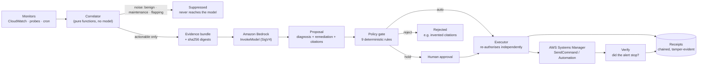
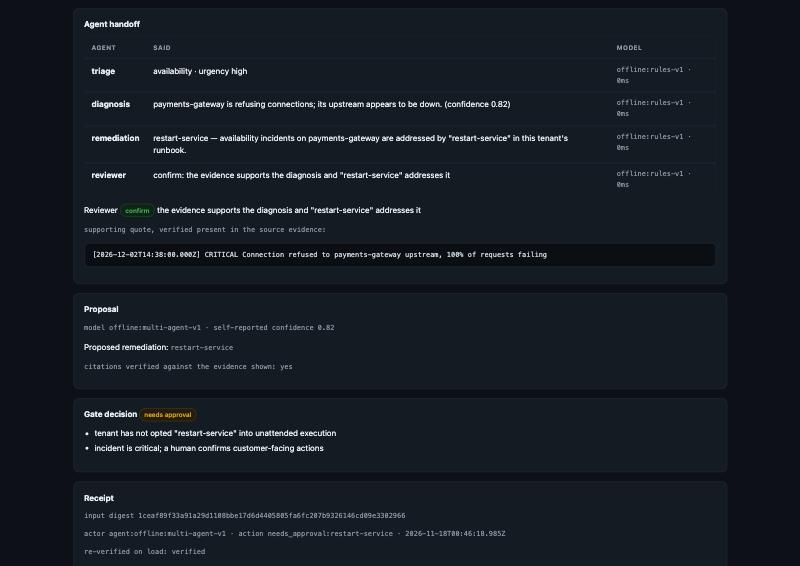

# NightShift

**Agentic on-call triage for MSPs. Deterministic correlation turns an alert flood into a handful of incidents, Amazon Bedrock diagnoses each one, and a policy gate decides whether a robot may act — with a verifiable receipt for every decision.**

Built for the **AWS MSP AI Hackathon**, Track 1: Run Your MSP Better.

**Live:** https://webrizz.dev/nightshift/ · **Video:** _(pending — script in [VIDEO.md](VIDEO.md))_ · **Limits:** [what this does not do yet](#honest-limits)

```
203 alerts  →  21 incidents  →  12 pages to a human
                                 6 auto-remediated · 6 held for approval
                                 6 SSM calls composed · 0 refused by the executor
                                 0 false auto-actions · 0 real incidents missed
```

---

## Stage One, in one paragraph

**Bedrock is the product, not a garnish.** The deterministic layer decides *what deserves attention*;
**four Bedrock agents** decide *what is wrong and what to do about it* — triage, diagnosis,
remediation and an adversarial reviewer, each handing a case file to the next. Delete the Bedrock call and there is no
diagnosis, no remediation proposal and nothing for the gate to grade — all that remains is a noise
filter. The AWS AI service sits in the live path at `src/agent/index.js`, called over SigV4-signed
Bedrock `InvokeModel` in `src/agent/bedrock.js`. The theme fit is direct: this is the
"multi-agent incident response / automated triage" example named in the Track 1 brief.

---

## How NightShift meets the judging criteria

Four criteria, 25% each.

| Criterion | How we meet it | Where |
|---|---|---|
| **Technological Implementation** | Bedrock in the live path, signed from scratch with zero dependencies. Around it: a pure-function correlation engine, a eleven-rule policy gate, tamper-evident evidence receipts, four specialist Bedrock agents with an adversarial reviewer, a two-tenant benchmark, a Systems Manager execution layer that re-authorises independently, and **84 passing tests** including fault-injection ones. | [§1](#1-technological-implementation) |
| **Design** | The whole on-call loop in one console: what came in, what was suppressed and why, what the model proposed, what the gate decided, what a human still owes. Multi-tenant from the contracts up — **onboarding a customer is writing a JSON rule pack, not editing code**. | [§2](#2-design) |
| **Potential Impact** | A reproducible benchmark with a published baseline: **94.1% of alert volume removed, with zero real incidents missed**. Every number regenerates from `npm run eval`. | [§3](#3-potential-impact) |
| **Innovation / Idea** | The novelty is *where the model sits*. It proposes; code decides. A proposal that cites evidence it was never shown is rejected automatically, and nothing irreversible ever runs unattended. | [§4](#4-innovation--idea) |

---

## 1. Technological Implementation

### Architecture



### The four layers, and why each exists

**1. Correlation (`src/correlate.js`) — deterministic, no model.**
Groups alerts by a normalised signature within a tenant's window. State verbs collapse to `<state>`
so `"Health check failed"` and `"Health check recovered"` land in **one** incident — without that, a
flapping probe looks like two healthy groups and is never detected as a flap. Classifies each
incident as `actionable`, `known_benign`, `suppressed_window`, `flapping` or `duplicate`.
Same alerts in, identical incidents out, always.

This also keeps the token bill sane: at MSP volume you cannot afford to send 203 alerts to a model.
We send 12 incidents.

**2. The agents (`src/agent/`) — Amazon Bedrock, four of them.**
Multi-agent incident response, which is the Track 1 brief's own wording:

| Agent | Job | Sees |
|---|---|---|
| **triage** | what kind of failure is this, how urgent | alerts + runbook |
| **diagnosis** | what is actually wrong (prompt specialises per category) | + triage output |
| **remediation** | which action from *this tenant's* runbook, and why | + diagnosis |
| **reviewer** | adversarial: does the action follow from the evidence? | + the proposal |

Each turn's output becomes evidence for the next with its own sha256, so the console shows the
handoff rather than asserting it. Pipeline confidence is the **weakest link**, not the loudest agent.

The reviewer is the reason there are four. A single agent that proposes *and* justifies its own
proposal will justify anything; a separate agent whose only job is to disagree, that cannot see the
first agent's confidence, catches the cases where diagnosis and action have quietly come apart.

**And the reviewer is not trusted either.** To confirm, it must quote the evidence verbatim — and
code checks that the quote is really there, in **source** evidence only. Quoting another agent's
output back is not corroboration, and a confirmation whose quote cannot be found is automatically
downgraded to a dissent.

Bedrock is called over plain HTTPS with **SigV4 signed in `node:crypto`** (`src/agent/bedrock.js`).
No SDK, no `npm install`, nothing to break on a judge's machine.

**3. The gate (`src/policy.js`) — code decides.**
Eleven rules, each one an answer to a question a customer will ask in a post-incident review:

| Rule | Outcome |
|---|---|
| Model cited evidence it was never shown | **reject** — a model that invents its justification is unusable |
| Reviewer flagged the action as unsafe | **reject** |
| Reviewer dissented | hold — a second opinion against it costs the unattended path |
| Remediation is not in this tenant's rule pack | **reject** |
| Incident was classified as noise | **reject** — nothing acts on suppressed traffic |
| Action is irreversible | hold for a human, always, no override |
| Blast radius is high | hold |
| Tenant has not opted this action into unattended use | hold |
| Rate limit reached for this action | hold — an agent in a loop is worse than no agent |
| Model confidence below 0.75 | hold |
| Incident is critical | hold — customer-facing calls stay human |

Everything else auto-remediates. Every verdict carries the list of rules that fired, in order.

**4. The executor (`src/execute/`) — AWS Systems Manager.**
Approved remediations reach real infrastructure through SSM `SendCommand` (run a document against
tagged instances) or `StartAutomationExecution` (a runbook), both polled to a terminal state,
because "the command was sent" is not "it worked".

It is built on the assumption that it will one day be asked to do the wrong thing:

| Safeguard | Why |
|---|---|
| **Re-authorises from the rule pack** | It does not trust the verdict it was handed. Hand it a forged `auto_remediate` for a region failover and it still refuses. Defence in depth, and a test proves it. |
| **Idempotent per (incident, remediation)** | An agent that retries does not restart the service four times. A repeat returns the original record. |
| **Dry-run by default** | Touching infrastructure needs `EXECUTOR_MODE=live` **and** credentials **and** a tenant opt-in. |
| **Every auto-executable action documents its undo path** | Enforced by a test: no undo, no unattended execution. |
| **Receipts chain** | The execution receipt carries the input digest of the decision receipt that authorised it, so the trail runs from raw alert to infrastructure change. |
| **Verification afterwards** | Did alerts matching this signature stop recurring in the window? That is the number a customer actually cares about. |

### Receipts

Every decision stores the evidence verbatim, its sha256, and a digest over the ordered list.
Editing evidence after the fact, swapping it, or reordering it all break verification — and the
console re-verifies on load. "Why did your robot restart my service at 4am?" has an answer that is
not a log line.

### Tests

```
$ npm test
ℹ tests 75
ℹ pass 75
ℹ fail 0
```

Including: hallucinated citations rejected, irreversible actions never unattended, rate limits
honoured, critical incidents always held, tenant isolation, receipt tampering detected, a forged
verdict still refused by the executor, idempotent re-execution, live mode failing loudly rather than
silently "succeeding" without credentials, a reviewer confirmation downgraded when its quote is not
in the evidence, quoting another agent's output rejected as corroboration, a failing specialist
degrading to the single agent rather than stopping, and a test that asserts the published headline
numbers so the README cannot silently drift from the code.

---

## Measured against live Bedrock

Run on 18 November 2026 in `us-east-2`, against `us.amazon.nova-pro-v1:0` through the Converse API,
on an AWS CloudShell task role with **no static credentials anywhere**. Both datasets, one run each,
temperature 0. Raw run files are written to `runs/` by `npm run eval`.

**The hosted console is this, not a mock.** <https://webrizz.dev/nightshift/> is a static snapshot
of a third live Bedrock run (`72a81c1b`); its footer names the model and the run id, the diagnoses
are the model's own prose, and the dissents are on the incident pages. It renders a real run — it
does not call Bedrock on page load.

| | Training set | Held-out set |
|---|---|---|
| Run id | `537d1b89` | `8dd203c7` |
| Alerts in | 203 | 140 |
| Incidents after correlation | 21 | 18 |
| Actionable (paged) | 12 | 18 |
| Reduction, alerts → pages | **94.1%** | **87.1%** |
| Auto-remediated | 3 | 2 |
| Held for human approval | 9 | 16 |
| Reviewer dissents | 9 | 15 |
| Degraded to single agent | 1 | 1 |
| Median time to proposal | 9,169 ms | 9,059 ms |
| **False auto-remediations** | **0** | **0** |
| **Missed real incidents** | **0** | **0** |

Three things in that table are worth more than the headline percentage.

**The reviewer caught the model citing evidence that did not exist.** The most common reason an
action was held back reads, verbatim from the run:

> `reviewer dissented: reviewer confirmed but its supporting quote is not present in the evidence`

The reviewer agent said "confirmed" and supplied a quote to justify it. `quoteIsReal()` checked that
quote against the source evidence — the alerts and the runbook, never another agent's output — and
it was not there. The model fabricated a citation and deterministic code caught it and downgraded
the verdict to a dissent, which costs the unattended path at the gate. That is the entire thesis of
this project happening against a real model rather than being asserted about one.

**Automation falls on unfamiliar traffic.** 3 of 12 actionable incidents auto-remediated on the
training set (25%); 2 of 18 on the held-out set (11%). The held-out set uses different services,
different wording and two failure classes no rule was written for. The system became *more*
cautious where it knew less, which is the behaviour the confidence floor and the reviewer exist to
produce — and it did so with a live model, not a rules baseline.

**Both safety numbers are zero on data the rules never saw.** Zero wrong actions taken unattended,
zero real incidents suppressed. `npm run eval` exits non-zero if either moves, and CI runs it.

### What the live run found that no amount of local testing had

Running against real AWS immediately exposed three defects that 75 passing tests had not, each now
fixed and covered by a regression test:

1. **SigV4 signed the wrong path.** AWS URI-encodes every path segment *twice* in the canonical
   request for every service except S3. The client signed the singly-encoded path, so every Bedrock
   call returned `403 The request signature we calculated does not match`. It had gone unnoticed
   because Systems Manager signs path `/`, where both forms are identical — only a model id
   containing a colon, which is every current inference profile, exposes it.
2. **Temporary credentials were captured once and held.** A run began fine and then lost 12 agent
   turns to `The security token included in the request is expired`. Credentials are now resolved
   per request, from the environment and then the container endpoint, and refreshed before expiry.
3. **A benchmark flag was silently ignored.** `--set=holdout` was dropped by a parser that only
   understood `--set holdout`, so a run intended to measure held-out traffic measured the training
   set and labelled itself `train`. Unknown flags are now refused rather than ignored.

A fourth defect was a published number that could not be true: the run report printed
`Did not recur 4/3`, because verified resolutions were counted over every result while executions
excluded refused and no-op ones. Same population now, and a test asserts the ratio can never invert.

### AWS deep dive

Everything AWS this project touches, where it lives, and what has — and has not — run against a
live account.

| AWS surface | What it does here | File | Status |
|---|---|---|---|
| **Bedrock `Converse`** | the four specialists: triage, diagnosis, remediation, review | [`src/agent/bedrock.js`](src/agent/bedrock.js), [`src/agent/multi.js`](src/agent/multi.js) | **run live** — see [Measured against live Bedrock](#measured-against-live-bedrock) |
| **SigV4** | request signing, written in `node:crypto` — no SDK | [`src/aws/sigv4.js`](src/aws/sigv4.js) | **run live**, shared by both clients |
| **Credential chain** | environment variables, then the container endpoint (ECS/Fargate/CloudShell), refreshed before expiry | [`src/aws/sigv4.js`](src/aws/sigv4.js) | **run live** on a task role with no static keys |
| **Systems Manager `SendCommand`** | run a document against tagged instances (rotate logs, re-run a batch) | [`src/execute/ssm.js`](src/execute/ssm.js) | implemented, polled to terminal state, **dry-run only** |
| **SSM `StartAutomationExecution`** | runbook-style remediations (restart a service, scale out) | [`src/execute/ssm.js`](src/execute/ssm.js) | implemented, **dry-run only** |
| **SSM `GetCommandInvocation` / `GetAutomationExecution`** | poll to a terminal state, because "sent" is not "worked" | [`src/execute/ssm.js`](src/execute/ssm.js) | implemented |

Why no AWS SDK: the whole project installs nothing. A judge clones it and runs it with `node` and
nothing else — no lockfile resolution, no transitive dependency that broke this week. Signing is
~60 lines and shared, so there is one implementation to audit rather than one per service.

Minimum IAM policy to run it live — `bedrock:InvokeModel` is the permission the Converse API checks:

```json
{"Version":"2012-10-17","Statement":[
  {"Effect":"Allow","Action":["bedrock:InvokeModel"],"Resource":"*"},
  {"Effect":"Allow","Action":["ssm:SendCommand","ssm:GetCommandInvocation",
    "ssm:StartAutomationExecution","ssm:GetAutomationExecution"],"Resource":"*"}]}
```

[`docs/iam-policy.json`](docs/iam-policy.json) is the tighter version worth deploying: Bedrock
scoped to Anthropic and Nova inference profiles, and Systems Manager scoped to instances carrying a
`nightshift-managed` tag, so the agent cannot reach an instance nobody opted in. It is written and
reviewed but not yet exercised against live SSM, so the permissive policy above is what the live
Bedrock run actually used.

## 2. Design

> "Can it be reproduced across different partner and customer environments?"

**Yes, and the repo proves it with two tenants that behave differently on identical traffic.**

There is no global config and no hardcoded environment. Every entry point takes a `tenantId` and a
`RulePack`. A rule pack is JSON: correlation window, flap threshold, maintenance windows, benign
patterns, and the catalogue of actions that tenant permits with per-action blast radius, rate limit
and opt-in. **Onboarding a customer is writing that file.**

| | Northwind MSP (internal NOC) | Acme Retail (managed customer) |
|---|---|---|
| Alerts in | 203 | 203 |
| Incidents | 21 | 21 |
| **Paged to a human** | **12** | **18** |
| Auto-remediated | 6 | 3 |
| Held for approval | 6 | 15 |
| False auto-actions | 0 | 0 |
| Missed real incidents | 0 | 0 |

Same code, same traffic, different outcomes — because Acme has not declared its benign log patterns
yet and has opted almost nothing into unattended execution. That is the correct behaviour for a new
customer: **a tenant you know less about pages you more.** Trust is configuration, and it is earned
per tenant rather than assumed globally.

### Built to scale

The correlation layer is not only a noise filter, it is the cost control. Only incidents that
survive it reach a model:

| | This pipeline | One model call per alert |
|---|---|---|
| Model calls over the benchmark | **48** | 203 |
| Reduction | **76.4%** | — |
| Prompt characters (measured) | 94,024 | ~397,000 |
| Estimated input cost @ $3/Mtok | **$0.07** | $0.30 |

Reproduce with `npm run impact`. Those token figures are an estimate from measured character
counts. The live runs now report tokens from Bedrock itself: **89,354 in / 24,608 out** across 94
agent turns for the 12 actionable incidents in the training set (~9,500 tokens per incident), and
**119,242 in / 35,194 out** across 142 turns for the 18 held-out incidents (~8,600 per incident).
Those are counts, not costs — multiply by whatever the model charges on the day.

The ratio holds as volume grows, because suppression happens before inference, not after. Nothing
is held in process memory between incidents except the idempotency ledger, so the server scales
horizontally; a real deployment points the ledger at DynamoDB (one interface, `src/execute/index.js`).

The console covers the loop: KPI header, actionable incidents with the model's diagnosis and the
gate's verdict, a separate panel for everything suppressed *with the reason*, and a detail page
showing exactly what the model was shown, what it proposed, which rules fired, and the receipt.
Approve or decline from the incident page. Approvals are **durable**: each one is written
atomically to disk with the digest of the decision it approved, replayed on boot, and survives a
restart or redeploy. Swapping the store for DynamoDB is one file (`src/store.js`) because the
server already awaits its three methods.

Dark, responsive, no build step, no framework.

---

## 3. Potential Impact

### The problem

An MSP NOC drowns. A single failing scheduled job re-fires every 45 seconds; a library logs an
expected skip at ERROR; a probe flaps. On-call stops reading alerts, and the one that mattered —
`payments-gateway` refusing 100% of requests — arrives in the middle of that.

### Measured outcome

Reproduce with `npm run eval`:

| | Northwind MSP |
|---|---|
| Alerts ingested | 203 |
| Incidents after correlation | 21 |
| **Paged to a human** | **12** |
| **Alert volume removed** | **94.1%** |
| Auto-remediated (reversible, opted-in, rate-limited) | 6 |
| Held for human approval | 6 |
| **False auto-remediations** | **0** |
| **Real incidents missed** | **0** |

The last two lines are the ones that matter. A noise filter that also swallows the real outage is
worse than no filter, so the evaluation grades against ground-truth labels the pipeline never sees,
and `npm run eval` **exits non-zero** if either number is above zero. It is a release gate, not a
dashboard.

### The business outcome, with its assumptions shown

`npm run impact` prints three blocks, deliberately separated, because they do not deserve equal
trust:

| Block | Example | How much to trust it |
|---|---|---|
| **MEASURED** | 203 alerts → 12 pages; 48 agent calls vs 203; 94,024 prompt characters | Reproducible on any machine |
| **ESTIMATED** | 23,506 input tokens, $0.07 | Arithmetic on measured characters at a published rate. Not an invoice |
| **ASSUMED** | 191 pages avoided → **159 on-call hours a month** | Depends entirely on "5 minutes to triage a page". At 2 minutes it is 64 h; at 10, 318 h |

The hours figure is the one an MSP cares about and the one I can least defend, so the tool prints
the sensitivity next to it rather than picking the flattering number. **The claim that needs no
assumption at all is 76.4% fewer model calls and zero missed incidents.**

### Does it hold on traffic it has never seen?

The obvious objection to everything above: the rules and the ground truth were written by the same
person, so scoring well on them proves less than it looks. So there is a **held-out set** —
different services, different wording for the same failures, and two classes no rule was written
for (certificate expiry, queue backlog).

```bash
node src/eval/run.js --set holdout
```

**The first held-out run failed.** Three noise incidents were auto-remediated — the exact thing the
safety number exists to prevent. The cause: `offlineTriage` matched symptom keywords across *all*
the evidence, and the evidence includes the runbook. The runbook says *"re-run the failed sync
batch"*, so every incident looked like a job failure. The classifier was reading the cure list.

The fix is a rule, not a patch for this dataset: **classify from symptoms only** — alerts and
metrics, never the runbook. The training set did not change at all, which is what tells you the fix
was principled rather than fitted to the held-out data.

| | Training set | Held-out set |
|---|---|---|
| Alerts | 203 | 140 |
| Pages to a human | 12 | 18 |
| Auto-remediated | 6 of 12 | **3 of 18** |
| False auto-remediations | 0 | **0** (was 3 before the fix) |
| Real incidents missed | 0 | 0 |

Read the auto-remediation row: on traffic it recognises, it automates half. On traffic it does not,
it automates a sixth and asks a human about the rest. **It automates less when it recognises less**,
which is the behaviour you want from something holding your customers' infrastructure. That is not
tuned in; it falls out of unknown categories scoring below the confidence floor.

Both datasets run in CI.

### What a judge should check

The reduction number is easy; the safety numbers are the claim. `src/eval/run.js` computes them from
labels attached by the generator and stripped before anything in the pipeline sees them
(`stripTruth()`), so the system is scored on data it was never shown the answers to.

---

## 4. Innovation / Idea

| Prior art | What it does | What NightShift does differently |
|---|---|---|
| Alert correlation (Opsgenie, BigPanda…) | Dedupes and groups alerts | Correlation is the *cheap* layer here; the agents only see what survives it |
| "LLM reads your logs" tools | Summarise incidents | Summaries are not decisions. Here an agent names an action from a tenant-specific catalogue, and code decides whether it may run |
| Auto-remediation runbooks | Fire on static rules | The rule chooses *whether*; the agents choose *which*, and must cite the evidence they used |
| Multi-agent demos | More agents, same trust | The reviewer can block, and must quote source evidence to approve — measured below, not asserted |



*One incident, end to end: four agents hand a case file along, the reviewer confirms with a quote verified
against the source evidence, the gate holds it anyway because the incident is critical, and the receipt pins
the inputs.*

### Does the reviewer actually earn its four model calls?

An adversarial reviewer that never disagrees is decoration. So the benchmark can inject a fault:
`--inject mismatch` swaps the chosen remediation for a **different action that is also
auto-approvable**, so the policy gate alone will not save us. The action is plausible, permitted,
and wrong.

| Pipeline | Clean run | With `--inject mismatch` |
|---|---|---|
| Single agent | 6 auto-remediated, 0 wrong | **6 wrong actions would run unattended** |
| Multi-agent | 6 auto-remediated, 0 dissents | **0 wrong actions**, 12 dissents |

Reproduce the whole table with one command — it is generated, not typed, so it cannot drift from
the code:

```bash
npm run compare
```

```
  pipeline   clean run                          with --inject mismatch
  ----------------------------------------------------------------------------
  single     6 auto, 6 held, 0 dissents        6 wrong actions would run, 0 dissents
  multi      6 auto, 6 held, 0 dissents        0 wrong actions would run, 12 dissents
```

The reviewer costs nothing when the pipeline is right — zero false dissents on the clean run — and
catches every injected fault. That is the whole case for multi-agent here, and it is measured.

The idea in one line: **the model proposes, deterministic code decides, and every decision leaves a
receipt.** That is what makes an unattended agent acceptable to an MSP that is contractually liable
for a customer's uptime.

---

## Run it (judges start here)

No AWS account, no credentials, no network, no `npm install`. Node 20+ only.

```bash
git clone <this repo> && cd nightshift
npm test                                      # 84 tests
npm run eval                                  # the benchmark, offline baseline
node src/eval/run.js --tenant acme-retail     # the second tenant
node src/eval/run.js --mode single            # one agent instead of four
node src/eval/run.js --inject mismatch        # hand it a wrong action on purpose
node src/eval/run.js --set holdout            # traffic the rules were never tuned for
npm run impact                                # business outcome and scale
node src/server.js                            # console on http://localhost:3000
node src/export.js                            # static export to dist/

# execution is dry-run unless you opt in explicitly:
EXECUTOR_MODE=live AWS_ACCESS_KEY_ID=... npm run eval
```

With Bedrock:

```bash
export AWS_REGION=us-east-2
export BEDROCK_MODEL_ID=us.amazon.nova-pro-v1:0   # an inference profile id, not a bare model id
AGENT_PROVIDER=bedrock npm run eval               # add --set holdout for the held-out set
```

No `AWS_ACCESS_KEY_ID` line: credentials resolve from the environment first and then from the
container endpoint, so on ECS, Fargate or CloudShell the task role is enough and nothing static is
stored. Both live runs below were produced that way.

The offline provider is the **published baseline**, not a mock of Bedrock: the eval runs the same
benchmark through either provider so the model's contribution can be measured rather than asserted.

## Continuous integration

`.github/workflows/ci.yml` runs on every push:

| Step | Fails the build when |
|---|---|
| `npm test` | any of the 84 tests break |
| eval, Northwind + Acme | a real incident is suppressed, or a wrong action auto-runs |
| eval, **held-out traffic** | the safety numbers stop holding on data the rules never saw |
| eval, single-agent baseline | the baseline regresses |
| `compare.js --assert` | the reviewer raises a false dissent, **or** an injected fault reaches unattended execution, **or** the fault turns out not to be dangerous enough to prove anything |
| `export.js` | the static build breaks |

The evaluation is a gate, not a report. A regression in the safety layer fails CI exactly like a
broken test, which is the only way a number in this README stays true.

```bash
npm run verify   # everything CI runs, locally
```

## Hosting

**Deployed:** https://webrizz.dev/nightshift/ — the static export, no setup, click straight through.
Approval buttons are inert there (no server); run `node src/server.js` for the live console.

Two paths, both committed:

| Target | File | Command |
|---|---|---|
| **Render** (live console, approvals work) | `render.yaml` | New → Blueprint → this repo |
| **Netlify / any static host** (read-only, no server) | `netlify.toml` | `npm run build:static`, publish `dist/` |

`node src/server.js` is a zero-dependency Node server with `/healthz`, `/api/metrics` and
`/api/incidents`. `node src/export.js` writes a fully static `dist/` (32 pages).

`EXECUTOR_MODE` is pinned to `dry-run` in both deploy configs. A public demo must never hold
credentials that can restart someone's service.

## For AI agents

Start with [`AGENTS.md`](AGENTS.md).

| Need | Where |
|---|---|
| Contracts and shared types | `contracts.js` |
| The four agents and their prompts | `src/agent/roles.js` |
| Multi-agent orchestration + degradation | `src/agent/multi.js` |
| Fault injection | `src/eval/faults.js` |
| Impact and scale model | `src/eval/impact.js` |
| Durable approval store | `src/store.js` |
| Deterministic correlation | `src/correlate.js` |
| The policy gate | `src/policy.js` |
| Bedrock call + SigV4 | `src/agent/bedrock.js` |
| Evidence receipts | `src/receipts.js` |
| SSM execution + re-authorisation | `src/execute/index.js`, `src/execute/ssm.js` |
| Shared SigV4 signer | `src/aws/sigv4.js` |
| Benchmark | `src/eval/run.js` |
| Synthetic traffic + ground truth | `src/synth/generate.js` |
| Tenant rule packs | `data/tenants/*.json` |

## Repo map

```
contracts.js        frozen shapes; every module imports from here
src/correlate.js    deterministic correlation and classification
src/policy.js       the gate: 9 rules, pure functions
src/receipts.js     sha256 evidence and tamper detection
src/agent/          four Bedrock specialists, orchestration, offline baselines
src/aws/sigv4.js    one SigV4 implementation, shared by Bedrock and SSM
src/execute/        Systems Manager execution, re-authorisation, verification
src/eval/run.js     the benchmark and the release gate
src/synth/          synthetic alert traffic with ground truth
src/server.js       the console
src/export.js       static export
src/store.js        durable approvals (atomic writes; swap for DynamoDB)
data/tenants/       one JSON file per customer environment
tests/              84 tests
.github/workflows/  CI: tests + the eval gate + the reviewer assertion
```

## New or significantly updated

Newly created during the submission period. Full history is in this repository.

---

## Honest limits

- **This does not import the Strands SDK.** It implements the Strands "agents as tools" handoff
  pattern directly on Bedrock, because the project is dependency-free by design. The orchestration
  shape is the same — narrow agents, explicit handoff, a reviewer that can refuse — but no Strands
  package is installed and the README does not claim one is.
- **On a clean benchmark, multi-agent and single-agent produce identical outcomes** (6 auto, 6 held,
  0 missed). The four-agent pipeline is not faster or more accurate here; its entire measured value
  is catching wrong actions, which only shows up under fault injection. Four model calls per
  incident instead of one is a real cost, and on this benchmark it buys exactly one thing.

- **The live model was Amazon Nova Pro, not Claude.** The account this ran in has Anthropic models
  disabled (`AccessDeniedException: anthropic.claude-sonnet-5 is not available for this account`),
  so the live figures come from `us.amazon.nova-pro-v1:0`. Because the client speaks Bedrock's
  Converse API, the model is one environment variable — but no Claude-measured number is claimed
  here, and a different family could behave differently.
- **Two runs is not a sample, and the runs differ.** The live figures are one run per dataset at
  temperature 0. They demonstrate that the path works end to end and that the gate holds; they are
  not a statistical claim about model quality. Temperature 0 is not determinism: a third run of the
  same training set (`72a81c1b`, the one the hosted console shows) auto-remediated **1** incident
  where the run in the table auto-remediated **3** — the model chose `open-ticket` more often. The
  safety numbers were zero in every run; the automation rate moved. Anyone reproducing this should
  expect the same.
- **The traffic is synthetic.** Every alert is generated by `src/synth/generate.js` from common MSP
  failure patterns. No customer, employer or production data appears anywhere in this repository.
  Seeded, so the numbers reproduce — but a synthetic benchmark is a demonstration of method, not a
  field result.
- **The executor has never run against live AWS.** It composes, signs and polls real Systems Manager
  calls, and the whole path is tested — but every run so far has been `dry-run`, so no SSM API has
  actually returned a response. The dry-run record shows the exact call that *would* be sent.
- **Dry-run verification is observational, not causal.** With nothing executed, "did not recur in
  30 minutes" reports what the alert stream did on its own; it does not show that a remediation
  worked. The console and the eval both label it that way rather than counting it as a win.
- **SSM document names are plausible, not provisioned.** `AWS-RunShellScript` is real;
  `NightShift-RegionFailover` is an example name a customer would create. Nothing auto-executable
  depends on a document that does not exist.
- **Ground truth is authored by the same person as the rules.** Partly addressed by the held-out
  set above, which caught a real bug the training set could not. But I wrote that too. A replay of
  anonymised production alerts, or someone else's labels, would be stronger evidence than either.
- **The held-out set is small** — four scenarios, 140 alerts. It is enough to have found one serious
  defect, not enough to claim generalisation.
- **Flap detection is heuristic.** Alternating severity plus recovery keywords catches the common
  case and will miss exotic ones.

## Licence

MIT — see [LICENSE](LICENSE).
